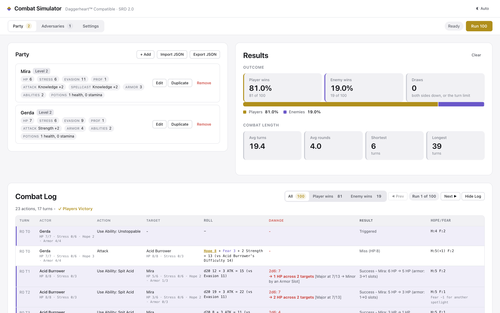
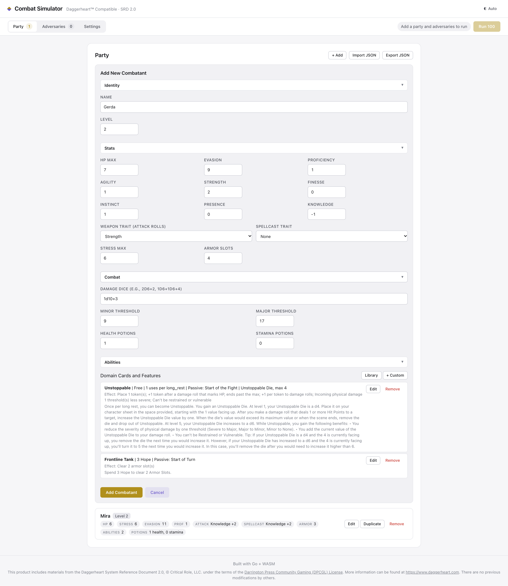
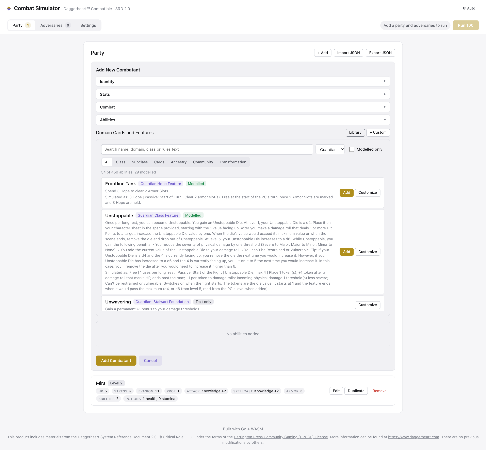
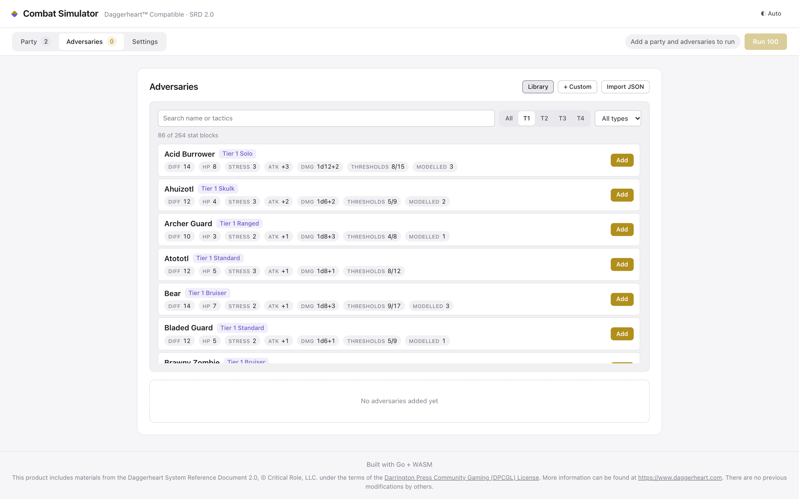
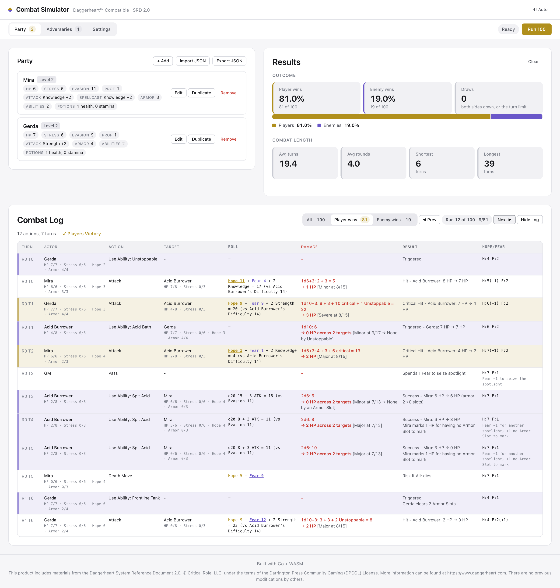
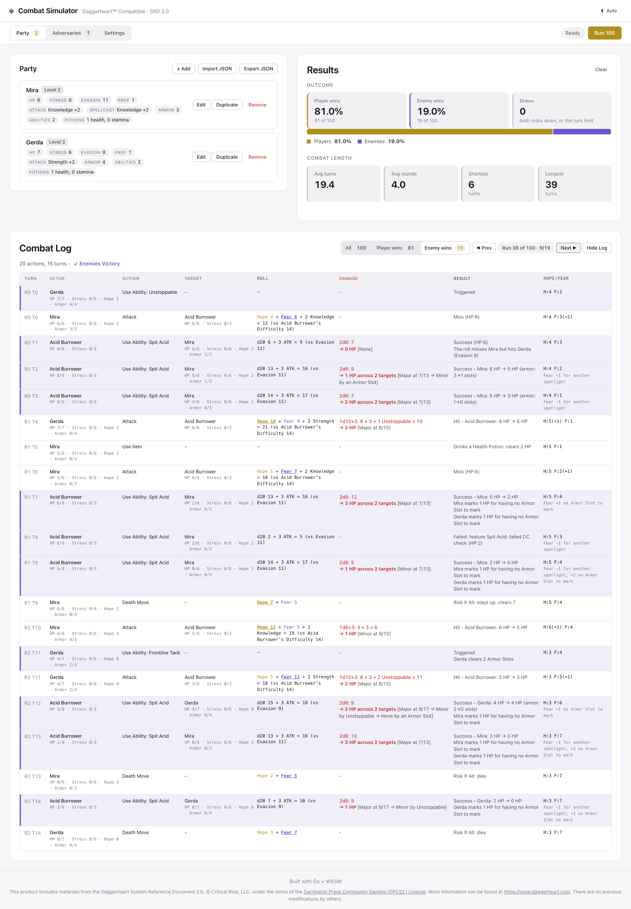

# Combat Simulator


A Daggerheart™ Compatible combat simulator, built on the SRD 2.0. Create a party, add some enemies and pit them against
each other a couple 100 times to see who comes out as a winner in the end!

Built with Go and WebAssembly ([go-app/v10](https://github.com/maxence-charriere/go-app)). Everything runs in your browser. No account, no cookies, no nothing.

> **Alpha.** The engine follows the SRD 2.0 rules, but it does not have all of them. See [What is not modelled](#what-is-not-modelled)
> for shortcomings.

## Quick Start

```bash
make run        # Build the WASM binary and the server, serve at http://localhost:8080
make test       # Run all tests
make help       # List every target
```

Requires Go 1.26.1 or newer and a modern browser.

## Using It

First, add a couple of players. Next, add a couple of adversaries. All 264 adversaries are in a neat, selectable drop down
which you can use to filter for certain types, levels and other criteria. These are created from the SRD 2.0 PDF (2026.11.22).
_Note_: You can also re-skin existing adversaries by editing already added ones, or create a completely new one.

Next, set how aggressive you want the simulator to behave in regard to spending Hope, Fear, Features, Actions, and
other moves. Be it random, aggressive, desperate it will change the outcome of the fight in some way.

Finally, hit `Run` and see how your party would do in a 100 or 1000 or 10.000 battles against your foes. Every battle is
a new one. Completely resets everything, so there is no need for "rests" in-between.

### Screenshots

**Main site**



**Add Player**



**Feature Selector**



**Enemy Library Selector**



**A run the players win**



**A run the enemies win**



### The Combat Log

Every action declares its source:

- **Roll**: each die and modifier by name, and the Difficulty or Evasion it was rolled against.
- **Damage**: formula, including all parts (additions, subtractions, etc.), the severity, and the number of Hit Points removed.
- **State**: HP, Stress, Hope, Armor for PCs, HP and Stress for adversaries.
- **Hope / Fear**: This one is clear. Fear will also contain how it changed in that row.

Passive features and other actions are listed before the action row. Things like, player activated Unstoppable.

## What has been parsed and modelled (so far)

### Rules

The following mechanics have been added:

- Duality dice
- Hope and Fear tracking
- Thresholds
- Armor Slots
- Stress
- Death moves
- Spotlight features (with _some_ caveats like, after configured number of Player successes the GM forcefully takes the spotlight spending Fear)
- Conditions (some): Burning, Poisoned, Vulnerable, Resistant, Stunned, Restrained, Taunted, Hidden, advantage and disadvantage
- Potions (just health and stamina)

### Abilities

All abilities that are relevant (things like gain a hope at the beginning of the session are irrelevant) are parsed and added
mechanics for. Some are text only, but are still there to be nice. Those that are relevant are marked as `modelled`.

| | Entries | Modelled |
|---|---|---|
| Adversary features | 905 | 430 (47.5%) |
| Player abilities and domain cards | 459 | 170 |

Most unmodelled player entries only matter outside a single fight (rests, sessions, downtime, permanent stat bonuses you set on the PC directly).
There are about 38 effect types currently: damage, healing, conditions, area damage, summons, tokens, armor, Stress, Hope, Fear, etc.
About 15 triggers, for example: `on_hit`, `on_damage_taken`, `start_combat` and costs in `Hope`, `Stress` or `Fear` with usage limits.

### AI Presets

Currently, there are four valid presets on how the AI should behave. The AI decides how to spend Hope and Fear basically.
Which means, taking the spotlight, using Relentless, triggering Hope features, etc.

- **Greedy**: spends resources freely, focuses the weakest target, Blaze of Glory
- **Conservative**: hoards resources, targets the biggest threat, Avoid Death
- **Desperate**: spends resources when low on Hit Points, Risk It All
- **Random**: random

## What Is Not Modelled

- Ranges and movement. Every target is in reach, and an area effect catches a set number of targets.
_Note_: Adding ranges to the simulation would massively complicate everything. Positioning, avoiding attacks, kiting...
Maybe sometime in the future...
- Hidden and Cloaked as stealth, countdowns, environments.
- Druid Beastform, the Ranger companion, Brawler Martial Stances. (Druid is in the works.)
- Dice pools (Rally, Slayer, Favor, Focus) and rerolls.
- Experiences, Help an Ally, Tag Team Rolls. (Tag Team Rolls is in the works.)
- Rests. Irrelevant, every fight starts from scratch.

## License and Attribution

The code is licensed under the Apache License 2.0, see [LICENSE](LICENSE).

This product includes materials from the Daggerheart System Reference Document 2.0, © Critical Role, LLC. under the terms of the Darrington Press Community Gaming (DPCGL) License. More information can be found at https://www.daggerheart.com. There are no previous modifications by others.

The SRD text in `data/` was converted to JSON, and the mapping files describe that text as engine effects. The Darrington Press Community Gaming License is at https://www.darringtonpress.com/license.

Darrington Press™ and the Darrington Press authorized work logo are trademarks of Critical Role, LLC and used with permission.

This project is not affiliated with, sponsored by or endorsed by Darrington Press or Critical Role.
